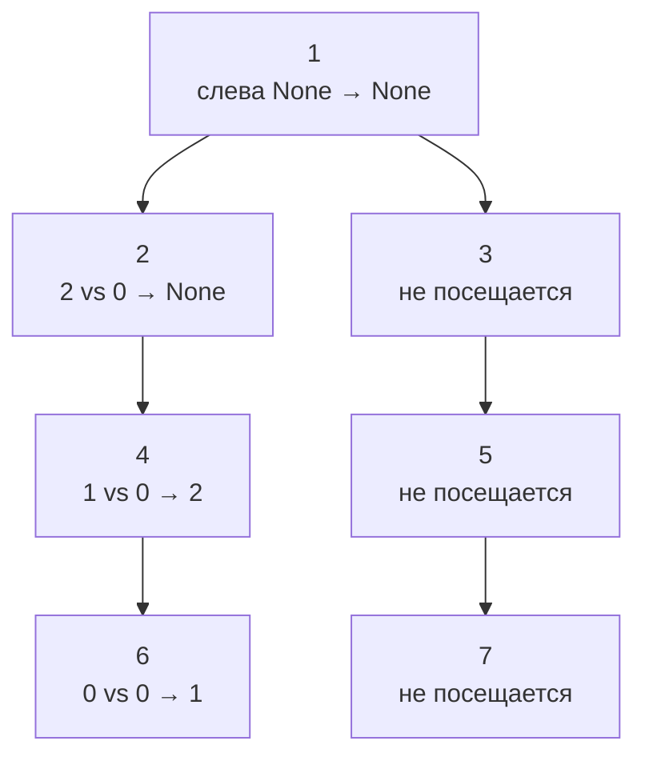
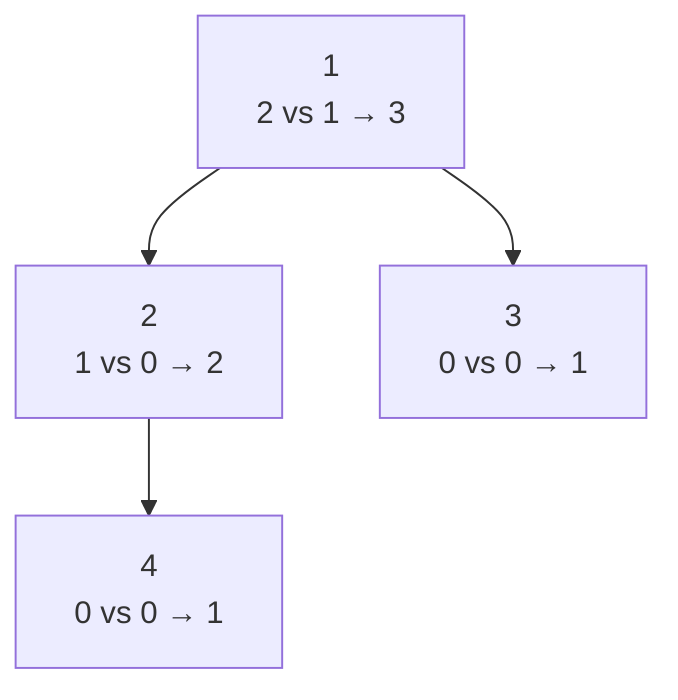

# Объяснение решения

Высота узла по сути это 1 плюс наибольшая из высот его детей. Чтобы её посчитать, функция сначала получает высоты обоих поддеревьев. В этот момент у неё на руках ровно то, что нужно для проверки баланса узла, поэтому сравнение делается в том же вызове.
у мя `_height` возвращает `int | None`: число означает высоту поддерева, `None` — что внутри поддерева УЖЕ найдено нарушение.

## Оценка сложности

h - высота дерева.

### Время

O(n): каждый узел обрабатывается один раз, высоты не пересчитываются. После первого найденного нарушения оставшиеся поддеревья не посещаются.

### Память

O(h) на стек рекурсии.
Для сбалансированного дерева это O(log n).

## Визуализация

### Несбалансированное дерево

Рядом с каждым узлом — высоты левого и правого поддеревьев и то, что вернёт `_height`:

Порядок вызовов: рекурсия спускается до листа 6, а результаты поднимаются снизу вверх.

| Шаг | Узел | Слева | Справа | Разница | `_height` возвращает |
| --- | --- | --- | --- | --- | --- |
| 1 | 6 | 0 | 0 | 0 | 1 |
| 2 | 4 | 1 | 0 | 1 | 2 |
| 3 | 2 | 2 | 0 | **2** | `None` |
| 4 | 1 | `None` | — | — | `None` |

Нарушение у узла 2 обнаружено в том же вызове, где считалась его высота. Корень получает `None` от левого ребёнка и сразу возвращает его, не заходя в правое поддерево. Итог — `False`.

### Сбалансированное дерево

Разница высот 1 допустима:

Ни один узел не вернул `None`, высота дерева 3, итог — `True`.

## Тесты

| Дерево | Ожидание | Что проверяет |
| --- | --- | --- |
| `None` | `True` | пустое дерево |
| 1 | `True` | один узел |
| 1 → (2 → 4), 3 | `True` | разница 1 допустима |
| дерево с картинки выше | `False` | нарушение не в корне |
| 1 → левый 2 → левый 3 | `False` | перекос влево |
| 1 → правый 2 → правый 3 | `False` | перекос вправо (без `abs` не ловится) |
