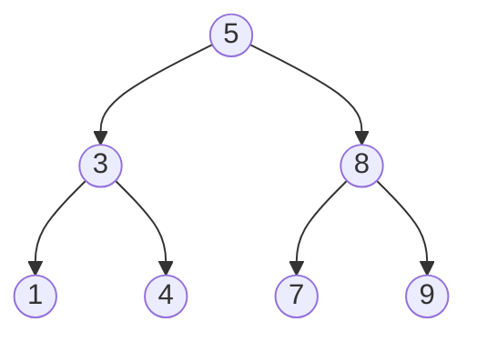

# Объяснение решения

Реализовал ноду дерева - узел|лист.
После этого реализовал BST с обычным проходом по дереву и вставкой на None позицию.
Самое интересное кроется в приватоном методе - _travel_tree
Код сжал, вынес повторяющуюся логику.

## Оценка сложности

Думаю тут нужно сказать про вставку и любой вывод сортировки.

### Скорость

вставка - O(h) - мы же просто каждый раз либо влево, либо вправо прыгаем и всё упрётся в реальную глубину дерева.

вывод сортировки - O(n) - выводить приходится всё, что есть в дереве.

### Память

вставка - O(1) - по сути мы создаём новый узел. Там есть значение + ссылки.

сортировка - O(n) - выводим массив, в него пишем.

## Визуализация

Дерево после вставки `5, 3, 8, 1, 4, 7, 9`:

| Обход | Порядок | Результат |
| --- | --- | --- |
| `pre_order` | NLR | 5, 3, 1, 4, 8, 7, 9 |
| `in_order` | LNR | 1, 3, 4, 5, 7, 8, 9 |
| `post_order` | LRN | 1, 4, 3, 7, 9, 8, 5 |
| `reverse_pre_order` | NRL | 5, 8, 9, 7, 3, 4, 1 |
| `reverse_in_order` | RNL | 9, 8, 7, 5, 4, 3, 1 |
| `reverse_post_order` | RLN | 9, 7, 8, 4, 1, 3, 5 |

Здесь h = 3, а n = 7: дерево сбалансировано, h ≈ log n.

Худший случай — вставка отсортированных `1, 2, 3, 4, 5`:

