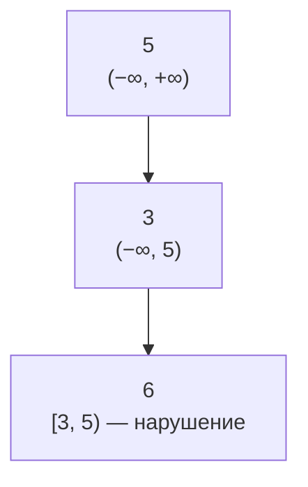
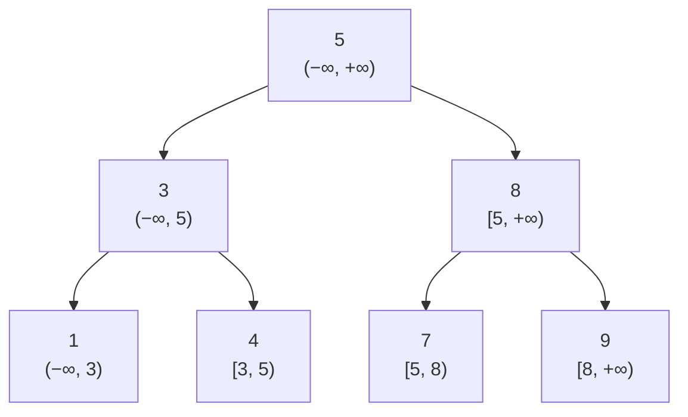

# Объяснение решения

Для каждого поддерева задаётся диапазон `[minimum, maximum)`, в котором должны лежать все его значения.
Эти границы передаются в каждый рекурсивный вызов.
Если значение узла выходит за свой диапазон - то очевидно false
Так ограничение от любого предка доходит до всех его потомков.

## Оценка сложности

h — высота дерева: от log n для сбалансированного дерева до n для вырожденного.

### Время

O(n): каждый узел проверяется не более одного раза.

### Память

O(h) - одновременно активны только вызовы на пути от корня до текущего узла.

## Визуализация

Некорректное дерево — рядом с каждым узлом его допустимый интервал:

Корректное дерево после вставки `5, 3, 8, 1, 4, 7, 9`:

