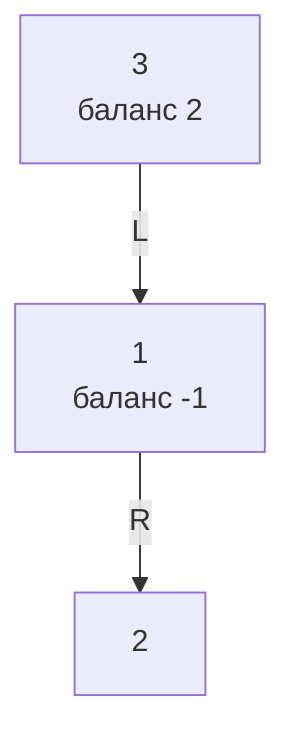
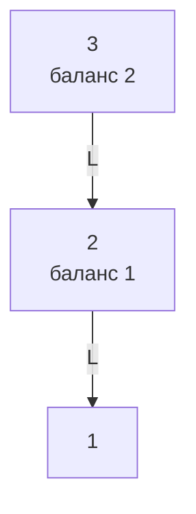
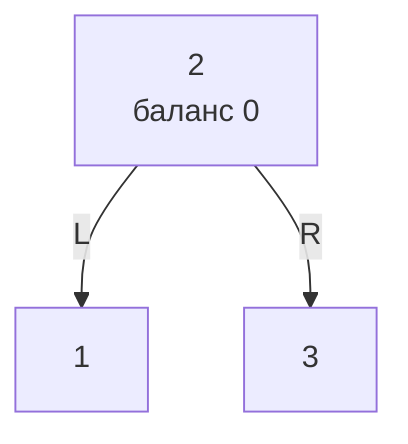

# Объяснение решения

Каждый узел хранит свою высоту.
Вставка и удаление спускаются рекурсией как в обычном BST, а на возврате каждый узел на пути пересчитывает высоту и баланс: высота левого поддерева минус высота правого.
Если баланс вышел за `[-1, 1]`, делается поворот: LL и RR одним поворотом, LR и RL двумя (сначала ребёнка, потом узла).
Приватные методы возвращают новый корень поддерева, родитель его переподвешивает, поэтому ссылки на родителя не нужны.
Узел с двумя детьми при удалении получает значение минимума правого поддерева, а сам минимум удаляется из правого поддерева.
Дубли при вставке игнорируются.

## Оценка сложности

n: количество узлов.
Высота AVL-дерева не больше ~1.44 · log n, поэтому любой путь от корня до листа O(log n).

### Время

Поиск, вставка, удаление: O(log n).
Поворот O(1), на пути их не больше O(log n).

### Память

Дерево: O(n).
Вставка и удаление: O(log n) на стек рекурсии.
Поиск итеративный: O(1).

## Визуализация

Случай LR при вставке `3, 1, 2`. Подписи на рёбрах: L левый ребёнок, R правый.

После вставки `2` у корня баланс 2, у левого ребёнка -1, это зигзаг:

Левый поворот вокруг `1` выпрямляет зигзаг в случай LL:

Правый поворот вокруг `3` балансирует дерево:

