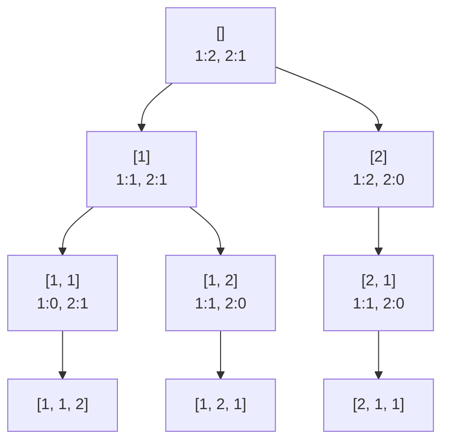

# Объяснение решения

Считаем, сколько раз встречается каждое число: словарь `{число: количество}`.
Рекурсия собирает перестановку в `row`: берём число с ненулевым остатком, уменьшаем остаток, спускаемся глубже, потом откатываем оба изменения.
Когда длина `row` равна n, в ответ кладётся её копия.
Словарь и `row` одни на все вызовы: в рекурсию передаётся ссылка, а не копия.
Одинаковые числа лежат под одним ключом, поэтому дубли перестановок не появляются.

## Оценка сложности

n: длина массива.

### Время

Подсчёт: O(n).
Рекурсия: O(n · n!), около e · n! вызовов, в каждом перебор словаря за O(n), плюс копия каждой из n! перестановок за O(n).

### Память

O(n) дополнительно: словарь, `row` и стек глубины n.

## Визуализация

Для `[1, 1, 2]`: в узле текущий `row` и остатки в словаре.

