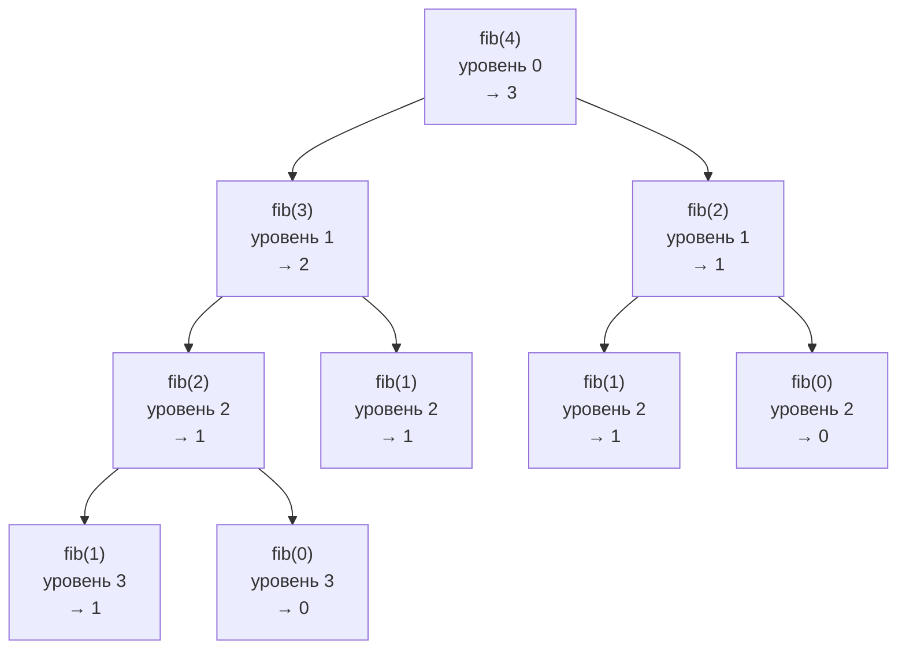

# Объяснение решения

После `@trace` имя функции указывает на `wrapper`.
Поэтому каждый рекурсивный вызов внутри функции тоже проходит через обёртку, и писать рекурсию в самом декораторе не нужно.
Глубина хранится в переменной `counter` в замыкании `trace`.
Она общая для всех вызовов одной декорированной функции, а `nonlocal` позволяет менять её изнутри `wrapper`.

## Оценка сложности

n: количество вызовов декорированной функции, h: максимальная глубина рекурсии.

### Время

O(1) дополнительно на каждый вызов, итого O(n) поверх времени самой функции.

### Память

O(1) дополнительно: один счётчик на функцию.
Глубина стека остаётся O(h).
Поэтому лимит рекурсии Python (по умолчанию 1000, `sys.getrecursionlimit()`) достигается примерно вдвое раньше.

## Визуализация

Ветвящаяся рекурсия `fib(4)`: рядом с каждым вызовом его уровень и результат.
После возврата из `fib(n - 1)` вызов `fib(n - 2)` идёт на том же уровне, потому что `counter` уже уменьшился.

