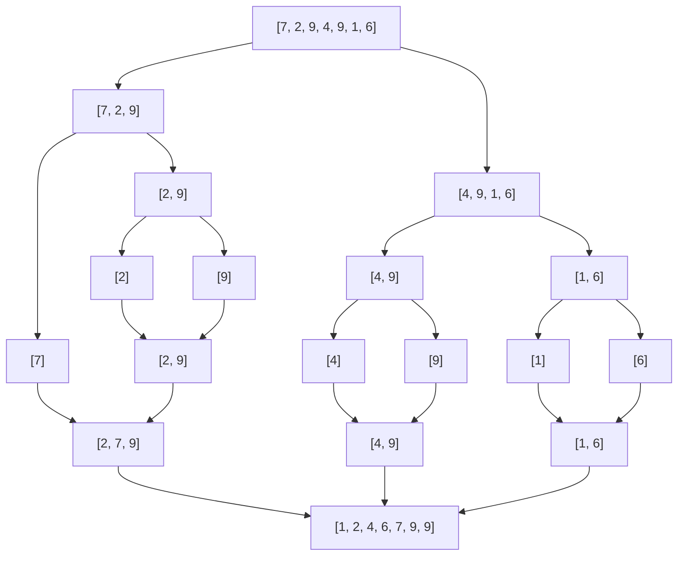
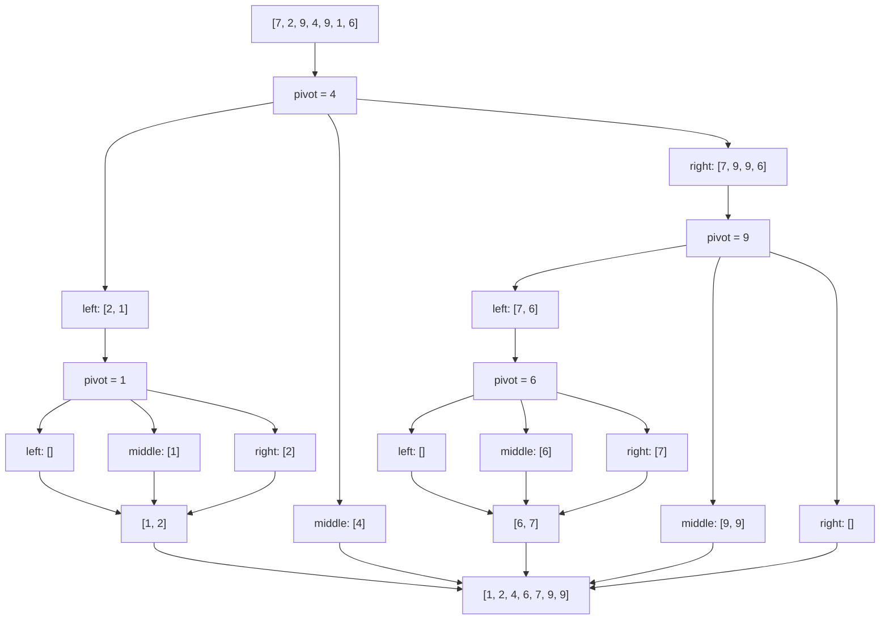

# Объяснение решений

## MergeSort

Реализовал дефолт.
Массив рекурсивно делится на две примерно равные части, пока в каждой части не останется не больше одного элемента.

Затем две отсортированные части сливаются в один массив.
Для этого используются два индекса: `x` для левой части и `y` для правой. На каждом шаге сравниваются текущие элементы, меньший добавляется в результирующий массив, а соответствующий индекс сдвигается.

Когда одна из частей заканчивается, оставшиеся элементы другой части добавляются в результат.

## QuickSort

На каждом рекурсивном шаге выбирается опорный элемент `pivot` — элемент из середины массива по индексу.

Массив разбивается на три группы:

- `left` — элементы меньше `pivot`;
- `middle` — элементы, равные `pivot`;
- `right` — элементы больше `pivot`.

Затем рекурсивно сортируются `left` и `right`. Результат формируется объединением отсортированной левой части, группы равных элементов и отсортированной правой части.

Группа `middle` позволяет не выполнять лишние рекурсивные вызовы для одинаковых элементов.

## Оценка сложности

`n` — количество элементов во входном списке.

### Время

**MergeSort:**

Лучший, средний и худший случаи: O(n log n).

**QuickSort:**

Средний случай: O(n log n).
Худший случай: O(n²).

### Память

MergeSort: O(n) дополнительной памяти на временные списки и результаты слияния.

QuickSort: в среднем O(n) дополнительной памяти на создаваемые подмассивы, в худшем случае — O(n²).

## Визуализация

### MergeSort

Пример сортировки массива `[7, 2, 9, 4, 9, 1, 6]`.

Сначала массив делится на части, затем отсортированные части последовательно сливаются:

### QuickSort

Для того же массива `[7, 2, 9, 4, 9, 1, 6]` центральный по индексу элемент — `4`.

- `left`: `[2, 1]`;
- `middle`: `[4]`;
- `right`: `[7, 9, 9, 6]`.

После рекурсивной сортировки частей они объединяются:

## Сравнительные тесты

Что интересного я тута сделал.
Для сравнения используются два массива, на которых текущая реализация QuickSort ведёт себя по-разному.

1. В первом массиве центральный по индексу элемент на каждом шаге оказывается минимальным. QuickSort каждый раз получает подмассив на один элемент меньше и вырождается до O(n²).
MergeSort сохраняет сложность O(n log n).
2. Во втором массиве все элементы одинаковые. QuickSort помещает их все в `middle` за один проход и работает за O(n). MergeSort продолжает делить и сливать массив за O(n log n).

Первый тест специально построен под выбор `pivot = arr[len(arr) // 2]`. При замене этого способа выбора опорного элемента результат эксперимента может измениться.
