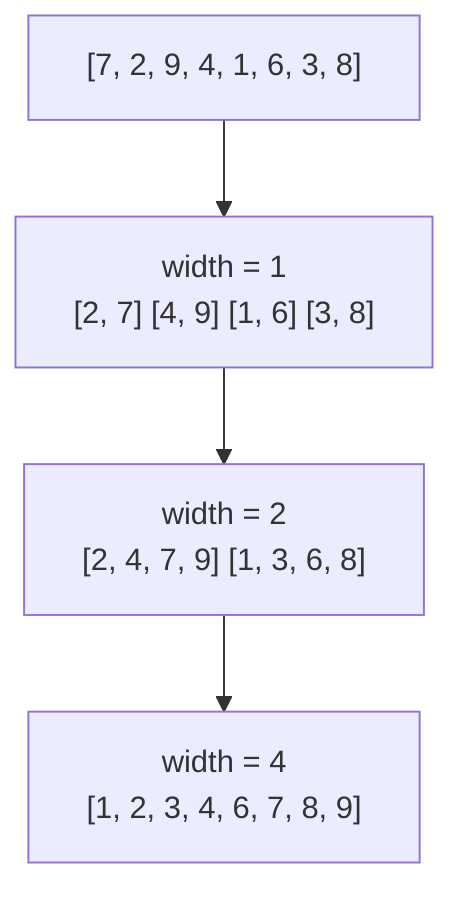
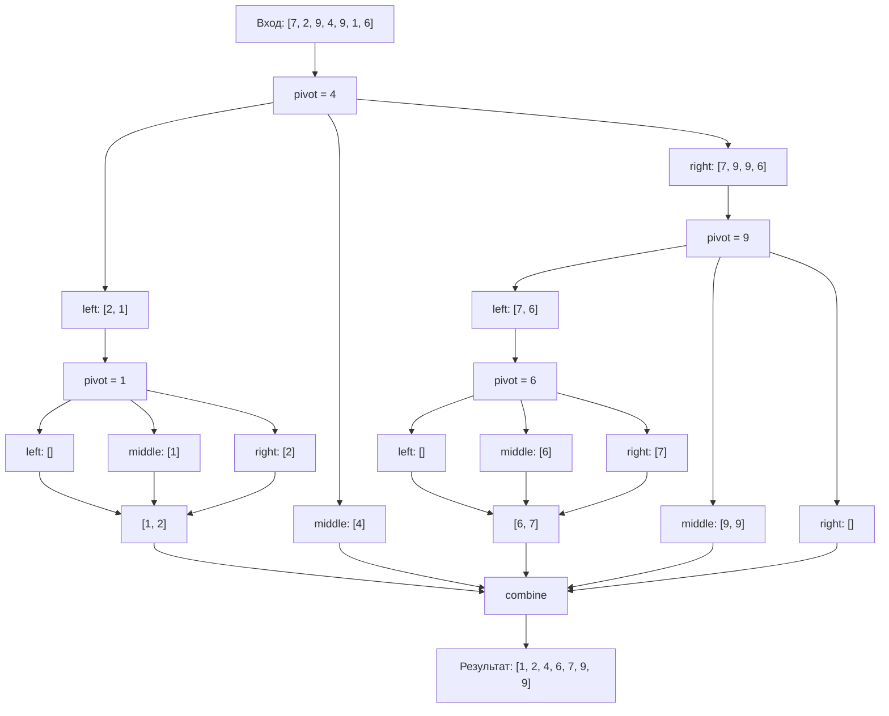

# Объяснение решения

**MergeSort**

Вместо рекурсивного разделения массива используется переменная `width`, которая определяет размер сортируемых участков.

Изначально `width = 1`, поскольку каждый отдельный элемент уже отсортирован.

На каждом проходе соседние участки объединяются в один отсортированный участок. Для слияния используются два индекса, которые указывают на текущие элементы левой и правой частей.

Результат записывается во вспомогательный массив. После обработки всех участков исходный и вспомогательный массивы меняются местами, а `width` увеличивается в два раза.

Алгоритм завершается, когда `width` становится не меньше длины массива.

**QuickSort**

Рекурсивные вызовы заменены собственным стеком `tasks`, в котором хранятся задачи сортировки и объединения результатов.

На каждом шаге извлекается очередная задача сортировки. Выбирается опорный элемент `pivot` — элемент из середины массива по индексу.

Массив разбивается на три группы:

- `left` — элементы меньше `pivot`;
- `middle` — элементы, равные `pivot`;
- `right` — элементы больше `pivot`.

Задачи сортировки `left` и `right` добавляются в стек. После их выполнения задача `combine` объединяет отсортированные части с группой `middle`.

Поскольку стек работает по принципу LIFO, сначала обрабатывается `left`, затем `right`, после чего выполняется объединение.

## Оценка сложности

`n` : количество элементов во входном списке.

### Время

**MergeSort:**

Лучший, средний и худший случаи: O(n log n).

**QuickSort:**

Средний случай: O(n log n).

Худший случай: O(n²).

### Память

MergeSort: O(n) - используется вспомогательный массив.

QuickSort: O(n) - создаются дополнительные подмассивы, стек задач и список результатов.

## Визуализация

MergeSort

Пример сортировки массива `[7, 2, 9, 4, 1, 6, 3, 8]`.

Размер объединяемых участков последовательно увеличивается: `1 → 2 → 4 → 8`.

QuickSort

Пример сортировки массива `[7, 2, 9, 4, 9, 1, 6]`.

На каждом шаге создаются задачи для сортировки подмассивов. После завершения обеих задач выполняется `combine`.

