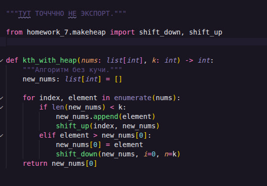

# Первоначальное решение

Первоначально я решил использовать минимальную кучу размером не более k элементов. Первые k элементов добавляются в неё через `shift_up`, после чего в куче поддерживаются k наибольших элементов из уже рассмотренной части массива. Минимальный среди них находится в корне кучи.



Таким образом, при k ≥ 2:

$$
T_1(N,k)=O(k\log k+(N-k)\log k)=O(N\log k).
$$

## Оптимизация решения

В предыдущей задаче уже была реализована функция `makeheap`. Поэтому вместо последовательного добавления первых k элементов можно взять срез `nums[:k]` и построить из него минимальную кучу за O(k).

Далее я прохожу по оставшимся элементам массива, начиная с индекса k. Если очередной элемент больше корня кучи, заменяю корень и выполняю `shift_down`. Иначе пропускаю элемент.

Таким образом, в куче всегда остаются k наибольших элементов из рассмотренной части массива, а после завершения обхода её корень является k-м наибольшим элементом исходного массива.

В реализации с `heapq` используется тот же подход: `heapify` для построения кучи и `heappushpop` для замены её минимального элемента.

### Память

Дополнительная пространственная сложность всех реализаций составляет O(k), поскольку хранится только куча из k элементов, а оставшаяся часть исходного массива обходится по индексам без создания дополнительного среза.

### Время

Создание среза и построение начальной кучи занимают O(k) времени. Сравнение оставшихся элементов с корнем занимает O(N − k), а каждое просеивание в худшем случае требует O(log k).

При k ≥ 2 получаем:

$$
T_2(N,k)=O(k+(N-k)+(N-k)\log k)
=O(k+(N-k)\log k).
$$

Оптимизация заключается в уменьшении сложности построения начальной кучи с O(k log k) до O(k). Чем ближе k к N, тем существеннее может быть выигрыш. При k = N сложность в худшем случае уменьшается с O(N log N) до O(N).

При k = 1 все реализации работают за Θ(N), поскольку сводятся к поиску максимального элемента.

## Визуализация

Рассмотрим массив `nums = [3, 2, 1, 5, 6, 4]`, k = 2.

Из первых двух элементов строим минимальную кучу `[2, 3]`.

```text
Начальная куча       Элемент 1          Элемент 5          Элемент 6          Элемент 4

      2                  2                  3                  5                  5
     /                  /                  /                  /                  /
    3                  3                  5                  6                  6

   [2, 3]    ───►    [2, 3]    ───►    [3, 5]    ───►    [5, 6]    ───►    [5, 6]
                  Пропускаем         Замена корня       Замена корня       Пропускаем
                                     + shift_down       + shift_down
```

В результате куча содержит два наибольших элемента массива: 5 и 6. Возвращаем корень кучи, то есть 5.
